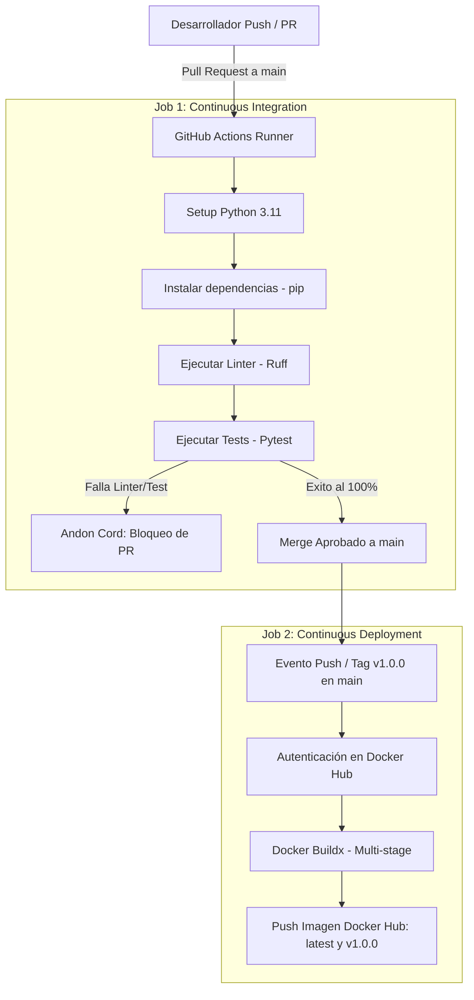

# 🚀 DevFlow - Plataforma de Gestión IT de Proyectos, Tareas e Incidentes

DevFlow es una plataforma web y API REST desarrollada para la gestión unificada de proyectos de software, administración de tareas y registro de incidentes IT. Este proyecto fue desarrollado aplicando metodologías, herramientas y principios del movimiento DevOps, Lean Software Development y la filosofía de Continuous Integration / Continuous Deployment (CI/CD).

---

## 🏛️ 1. Arquitectura de la Aplicación y Módulos

La solución se compone de tres módulos centrales interconectados:

- **Módulo Proyectos (`/projects`):** Creación, consulta, edición y eliminación de proyectos IT.
- **Módulo Tareas (`/tasks`):** Administración de actividades asociadas a un proyecto (`project_id`), con estados (*Pendiente*, *En progreso*, *Completada*).
- **Módulo Incidentes IT (`/incidents`):** Registro de fallas técnicas vinculadas a tareas y proyectos, categorizadas por prioridad (*Baja*, *Media*, *Alta*, *Crítica*).

### 📍 Endpoints Principales y Documentación

- `GET /health`: Health Check para monitoreo de disponibilidad.
- `GET /`: Dashboard SPA interactivo cargado en el navegador.
- `GET /docs`: Documentación interactiva Swagger UI / OpenAPI (Requisito obligatorio de validación).

---

## 🐳 2. Justificación Técnica y Decisiones de Diseño

### Dockerfile Multi-Stage & Seguridad

1. **Etapa `builder`:** Utiliza la imagen oficial ligera `python:3.11-slim` para compilar e instalar las dependencias necesarias.
2. **Etapa `runner` (Producción):** Copia únicamente el entorno virtual con dependencias compiladas y el código fuente. Se elimina el compilador C y paquetes innecesarios.
3. **Usuario Non-root (`appuser`):** La aplicación no se ejecuta como `root`. Se crea el usuario de sistema `appuser` (UID 1000) sin privilegios elevados para mitigar vulnerabilidades de evasión de contenedor.
4. **Optimización de Caché:** Se copia primero `requirements.txt` y se instalan dependencias antes de copiar el código de la aplicación.
5. **Sin tag `latest`:** Uso explícito de `python:3.11-slim` para garantizar la reproducibilidad exacta del entorno.

### Estrategia de Branching, Versionado y Protección

- **Estrategia de Ramas:** Uso estricto de Feature Branches (`feat/*`, `ci/*`, `test/*`).
- **Branch Protection Rules:** Reglas en GitHub que prohíben el `git push` directo a `main`. Todas las integraciones requieren un Pull Request (PR) aprobado por verificación de CI.
- **Conventional Commits:** Historial de commits estandarizado bajo el formato `feat:`, `fix:`, `ci:`, `test:`, `docs:`.
- **Semantic Versioning (SemVer):** Etiquetado de lanzamientos mediante tags semánticos de Git (`v1.0.0`).

---

## 🚀 3. Arquitectura del Pipeline de CI/CD (GitHub Actions)

El ciclo de vida del código está 100% automatizado mediante el archivo `.github/workflows/ci.yml`.


---

## ♾️ 4. Aplicación de la Filosofía DevOps (The Three Ways)

### 1ª Forma: Acelerar el Flujo (Left-to-Right)
- **Automatización Total:** Se eliminó la verificación y compilación manual. Cada Pull Request activa automáticamente el linter y la suite de 13 pruebas unitarias.
- **Paridad de Entornos:** La ejecución dentro de contenedores Docker mediante `docker-compose.yml` garantiza que el entorno de desarrollo sea idéntico al runner de CI y al entorno final.

### 2ª Forma: Bucles de Retroalimentación Rápida & Andon Cord
- **Mecanismo Stop-the-Line (Andon Cord):** Si un test unitario en `pytest` falla o el linter `ruff` detecta un error, el pipeline se frena de inmediato y bloquea el botón de Merge en GitHub.
- **Observabilidad Activa:** Detección inmediata de anomalías mediante logs estructurados en JSON en tiempo real ante errores `4xx` o `5xx`.

### 3ª Forma: Aprendizaje Continuo y Experimentación
- **Simulación de Falla Controlada:** Se realizó una prueba experimental creando la rama `test/andon-cord` con un test intencionalmente fallido (`assert response.status_code == 500`). El pipeline interrumpió el proceso, demostrando la efectividad de las salvaguardas automatizadas.

---

## 🗑️ 5. Principios Lean: Eliminación de Desperdicios (Muda)

Mediante la automatización del ciclo de vida en DevFlow, se eliminaron 3 desperdicios Lean críticos:

1. **Defectos / Retrabajo:** Evitados mediante la ejecución obligatoria de `pytest` y `ruff` en cada PR antes del despliegue.
2. **Trabajo en Proceso (WIP) e Esperas Manuales:** Se eliminó el tiempo de espera por revisiones manuales de código gracias a los runners paralelos de GitHub Actions.
3. **Procesamiento Extra:** Reemplazo del empaquetado manual por el empaquetado automático etiquetado con SemVer (`v1.0.0`) hacia Docker Hub.

---

## 📊 6. Observabilidad y Monitoreo (Golden Signals)

### Logs Estructurados en JSON

El servidor FastAPI emite logs enriquecidos a `stdout` en formato JSON en cada solicitud HTTP:

```json
{
  "timestamp": "2026-10-21T15:23:42Z",
  "level": "INFO",
  "message": "GET /tasks - 200",
  "method": "GET",
  "path": "/tasks",
  "status_code": 200,
  "duration_ms": 1.93,
  "client_ip": "127.0.0.1"
}

### Generador de Tráfico y Métricas

Se implementó el script `traffic_generator.py` para simular tráfico real continuo sobre los endpoints de la API, generando métricas para las **Golden Signals**:

- **Tráfico:** Conteo y distribución de peticiones por segundo.
- **Latencia:** Medición del tiempo de respuesta por endpoint (`duration_ms`).
- **Errores:** Registro y monitoreo de la tasa de respuestas `4xx` (simuladas mediante `GET /projects/999`) y `5xx`.

---

## 🛠️ 7. Guía de Ejecución Local

### Opción 1: Ejecución con Docker Compose (Recomendada)

```powershell
# Clonar el repositorio
git clone [https://github.com/MaximooMarcos/DevOps-Tp-Integrador.git](https://github.com/MaximooMarcos/DevOps-Tp-Integrador.git)
cd DevFlow

# Construir y levantar el contenedor
docker compose up --build -d

# Abrir en el navegador: http://localhost:8000

```

### Opción 2: Ejecución Local con Uvicorn

```powershell
# Crear y activar entorno virtual
python -m venv venv
.\venv\Scripts\Activate.ps1

# Instalar dependencias
pip install -r requirements.txt

# Ejecutar pruebas unitarias
python -m pytest

# Iniciar servidor de desarrollo
uvicorn app.main:app --reload